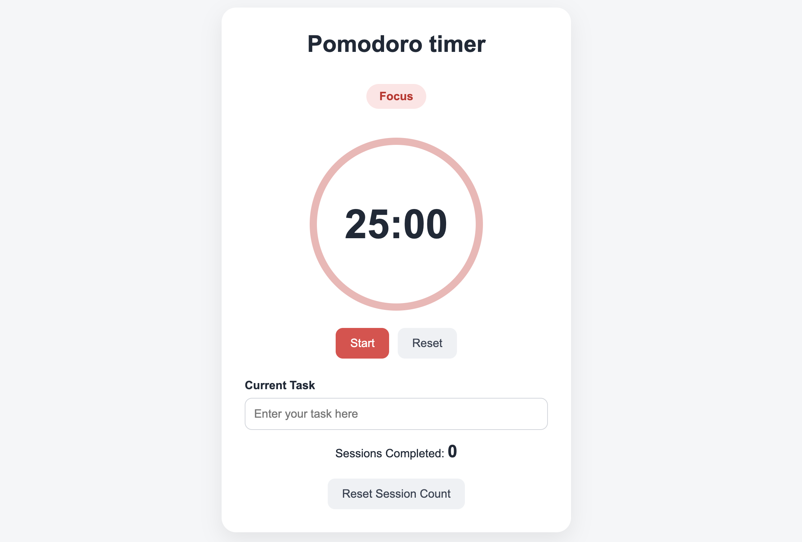

# Pomodoro timer

A simple Pomodoro timer built with HTML, CSS, and JavaScript.

## Features 

- 25-minutes Focus session
- 5-minutes Break session
- Automatic Focus / Break switching
- Completed session counter
- Current task input
- localStorage for saving task and session count
- Reset timer and reset session count
- Responsive UI

## How to use

1. Enter your current task.
2. Click Start button to tart Focus session.
3. When the Focus session end, the timer automatically switches to Break session.
4. Click Start button to start Break session.
5. Completed Focus sessions are counted automatically.

## Built with

- HTML
- CSS
- JavaScript
- localStorage

## Live Demo

GitHub Pages link:
